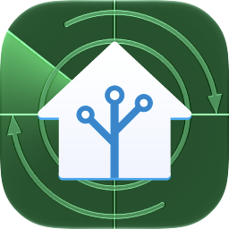
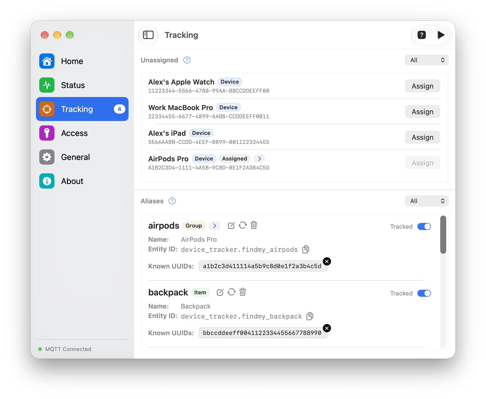
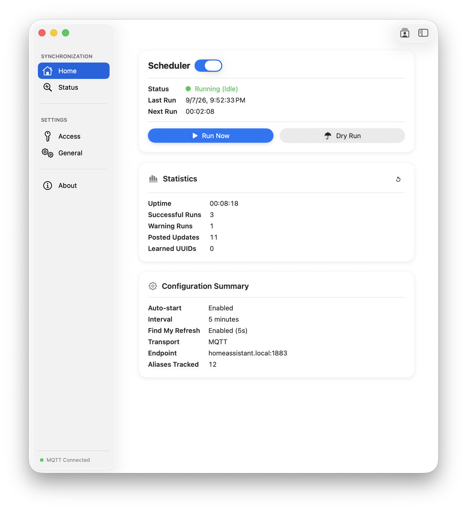
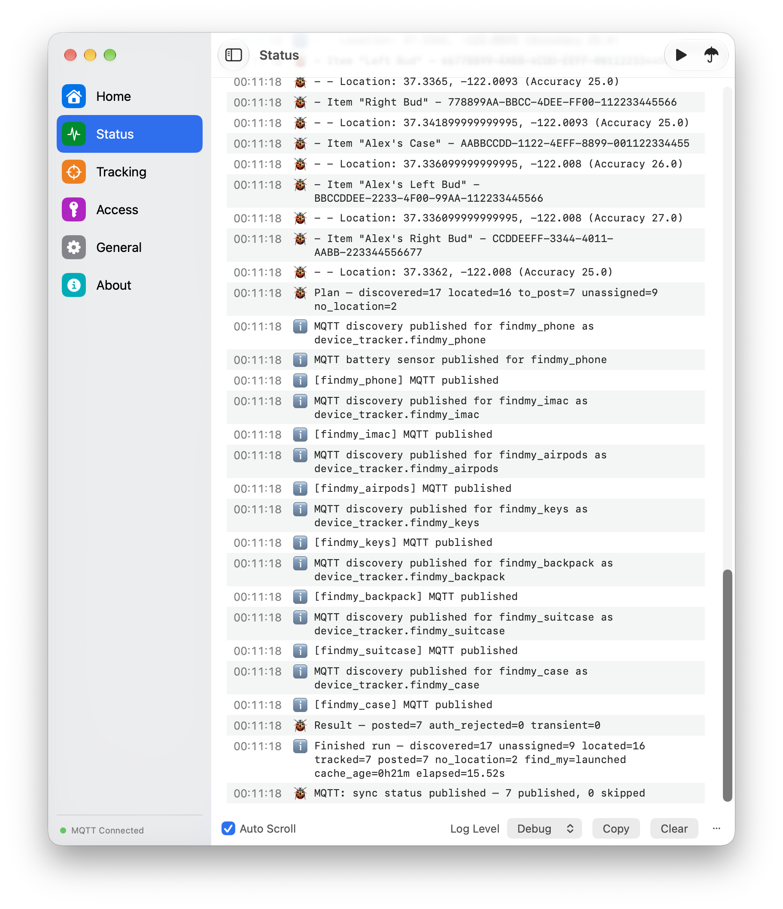
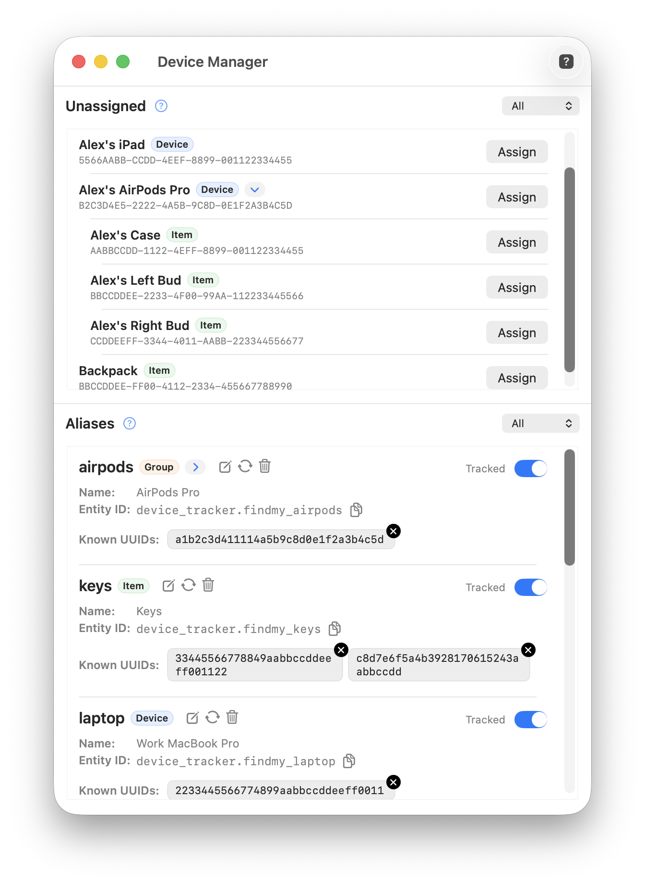
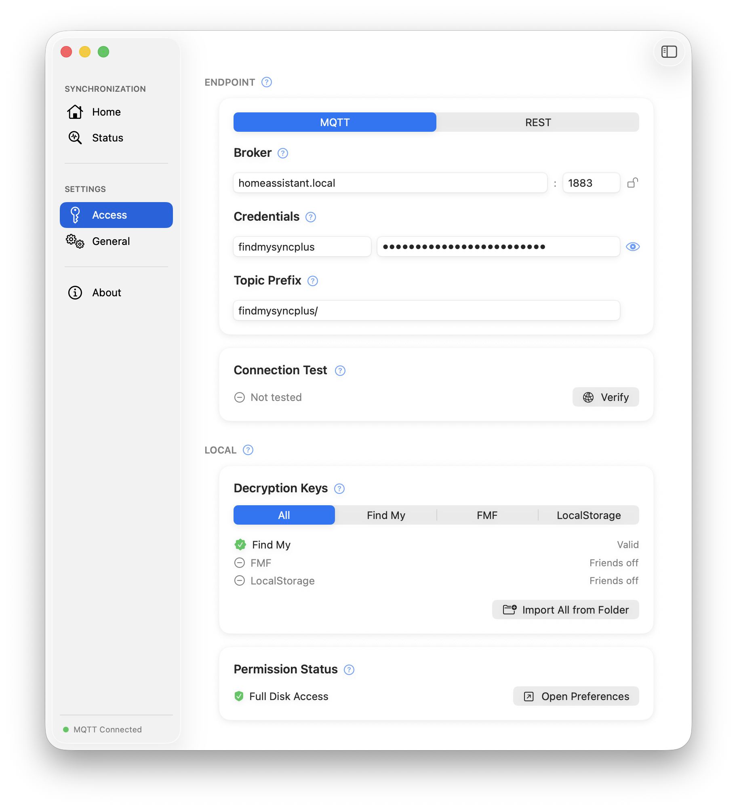
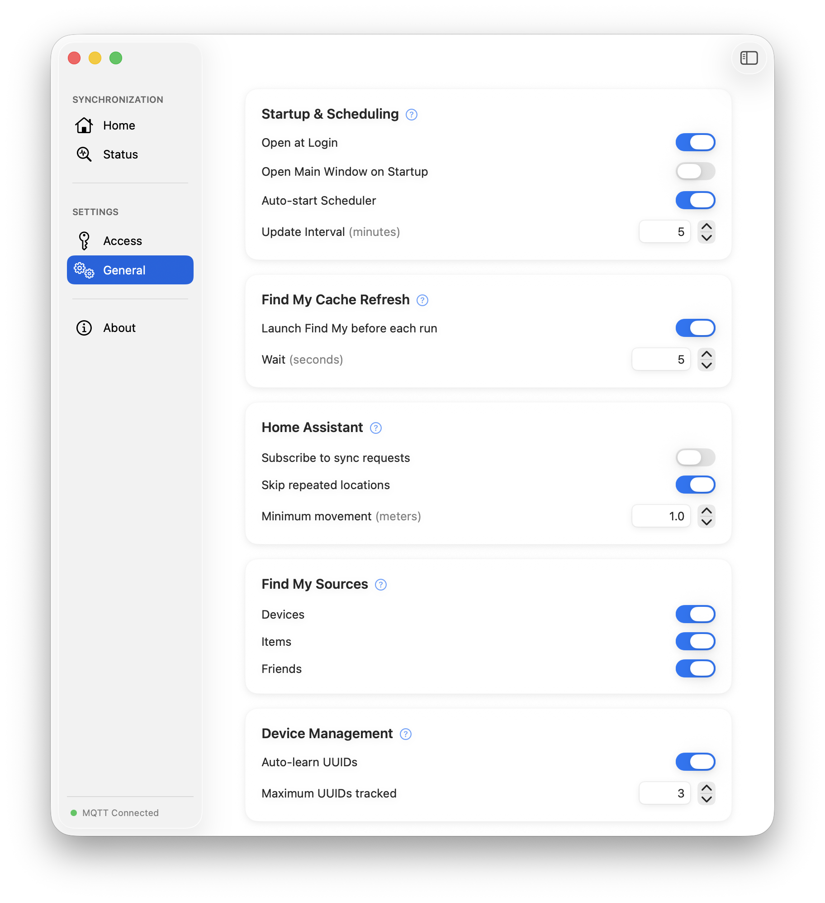
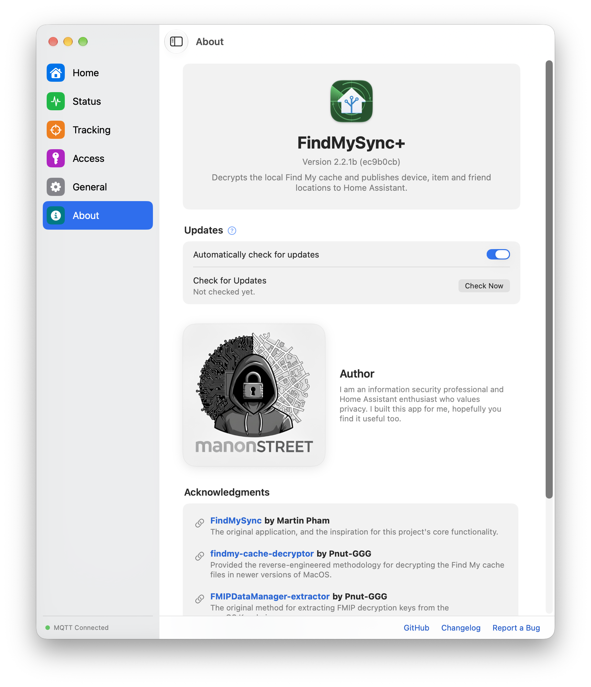

<p align="center">
  <picture>
    <source media="(prefers-color-scheme: dark)" srcset="screenshots/icon-dark.png">
    
  </picture>
</p>

<h1 align="center">FindMySync+</h1>

<p align="center">
  <a href="https://github.com/manonstreet/FindMySyncPlus/releases/latest"></a>
  
  
  
</p>

<p align="center"><strong>Publish Apple Find My locations to Home Assistant: devices, items and friends, privately and locally, with no third-party services.</strong></p>

<p align="center">
  
</p>

FindMySync+ (FMS+) reads your encrypted Find My cache files, decrypts them, and posts location updates directly to your Home Assistant instance on a configurable schedule. No cloud relay. No tracking service. Your Find My data goes straight to your home network and nowhere else.

It tracks Devices (iPhones, Apple Watch), Items (AirTags), and Friends, including their live locations. It publishes over **MQTT**, with Home Assistant auto-discovery and rich attributes, or over legacy **REST** (`device_tracker/see`). Rotating UUIDs are handled automatically, and all sensitive credentials are stored securely in the macOS Keychain.

Inspired by [FindMySync](https://github.com/MartinPham/FindMySync) by Martin Pham, and built on the decryption research by [Pnut-GGG](https://github.com/Pnut-GGG/findmy-cache-decryptor).

> Coming from FindMySync? FMS+ **works on macOS 14.4 and later**. See [Migrating from FindMySync](#migrating-from-findmysync).

---

## Why FindMySync+?

|  | FindMySync+ | FindMySync (original) | iCloud3 |
|--|:-:|:-:|:-:|
| macOS 14.4+ (encrypted caches) support | ✅ | ❌ | ➖ |
| AirTag / Items support | ✅ | ✅ | ❌ |
| Friend location tracking | ✅ | ❌ | ❌ |
| Auto-refresh Find My (no AppleScript) | ✅ | ❌ | ➖ |
| Auto-learn rotating UUIDs | ✅ | ❌ | ➖ |
| HA Mobile App on tracked devices | Not required | Not required | ⚠️ Recommended |
| Connects to Apple iCloud API | ➖ | ➖ | ✅ |
| Runs inside Home Assistant | ❌ Requires a Mac | ❌ Requires a Mac | ✅ |
| Initial setup complexity | 🟡 Moderate (key extraction) | 🟢 Low | 🔴 High |
| Ongoing configuration | 🟢 Low | 🟢 Low | 🔴 High |
| Update frequency | Configurable (≥1 min) | External AppleScript | Near real-time |

➖ Not applicable

---

## Features

**Tracking**

- **Devices, Items and Friends**: iPhone, Apple Watch, Mac, AirTags, and the people who share their location with you
- **Aliases**: a name you choose becomes the Home Assistant entity ID, and FMS+ re-links it when Apple rotates a device's UUID
- **Grouped accessories**: AirPods Pro are one entry, and the Case and each Bud can be tracked separately
- **Find My refresh**: optionally opens Find My before each sync to refresh its cache

**Home Assistant**

- **MQTT with auto-discovery**: Home Assistant creates the entities automatically, with altitude, speed, course, motion state and location labels as attributes
- **Battery sensor** for devices that report a battery level
- **Status and connection sensors**: the last successful sync, details of each run, and whether FMS+ is connected
- **Refresh button**: opens Find My and runs one sync, pressed from Home Assistant
- **Skip repeated locations**: publishes only when a location changes, with a minimum movement threshold
- **Legacy REST** (`device_tracker/see`) for setups without MQTT

**The app**

- **Menu bar app** that opens at login and runs on a schedule you set, with **Run Now** and **Dry Run**
- **Keychain storage** for your decryption keys and Home Assistant credentials
- **Automatic updates**: a daily check, installed from About
- **Logs** at four levels, with statistics for each run

---

## Privacy

- FMS+ decrypts the Find My cache on your Mac, in memory. It keeps decrypted locations in memory and never writes unencrypted location data to disk.
- FMS+ sends locations only to your Home Assistant, through your MQTT broker or REST endpoint, encrypted with TLS when you enable it for MQTT or use an `https` REST URL.
- FMS+ does not collect data about you and does not make use of analytics. Its only other connection is a daily update check against this project's release feed on GitHub, which you can turn off in About.
- Your decryption keys, Home Assistant token and MQTT password are stored in the macOS Keychain.
- Home Assistant stores the locations it receives, as it does for any tracker.

---

## Friend Location Tracking

Friend location tracking is rare among Find My tools. FMS+ does it through original reverse engineering of how Apple encrypts friend locations on the Mac. Apple discontinued the Find My Friends (FMF) API, and live friend coordinates are not available in the `.data` cache files that other tools read. The only remaining source is `LocalStorage.db` — an encrypted SQLite database owned by `findmylocateagent`.

FMS+ decrypts this database using the same AES-256 keystream XOR cipher that Apple's `libsqlite3` codec uses internally, discovered by reverse-engineering the `sqliteCodecCCCrypto` function.

**Family member dedup & enrichment** — Family members appear in both `Devices.data` (as shared devices) and `LocalStorage.db` (as friends). FMS+ automatically detects this overlap using Apple's universal person identifier (DSID) and skips duplicates, so each family member is only tracked once. Rich attributes from LocalStorage (altitude, speed, course, motion state) are merged onto the FMIP device entry, giving family members the best of both sources.

**Requires macOS 15 or later.** macOS 14 does not store friend locations, so there is nothing to process. The FMF and LocalStorage keys are not used there.

**Setup:** Import `LocalStorage.key` in the Access pane (extracted alongside the other keys in Phase 1) — the Friends source auto-enables when the key is imported.

---

## Screenshots

<p>
  <a href="screenshots/home_view.png"></a>
  <a href="screenshots/status_view.png"></a>
  <a href="screenshots/tracking.png"></a>
</p>
<p>
  <a href="screenshots/access_settings.png"></a>
  <a href="screenshots/general_settings.png"></a>
  <a href="screenshots/about_view.png"></a>
</p>

---

## Requirements

- macOS 14.4 (Sonoma) or later — 14.4 is where Apple began encrypting the Find My caches, which is what this app decrypts
- Friend locations require macOS 15 or later — on macOS 14 only the Find My key is needed
- A running Home Assistant instance with an MQTT broker (e.g. the Mosquitto add-on), or the legacy `device_tracker.see` REST API
- Find My encryption keys extracted from Keychain, a one-time step that needs SIP and AMFI temporarily disabled (see Phase 1 below)

---

## Getting Started

### Phase 1 — Extract Keys

Extract your Find My encryption keys using [findmy-key-extractor](https://github.com/manonstreet/findmy-key-extractor). This is a one-time step — keys are stable across reboots. Requires temporarily disabling SIP + AMFI; see the extractor README for the full procedure.

The extractor saves all three keys to a `keys/` folder:

| Key file | Enables |
|----------|---------|
| `keys/FMIPDataManager.bplist` | **Required** — device and item tracking (core feature) |
| `keys/FMFDataManager.bplist` | Friend metadata |
| `keys/LocalStorage.key` | Friend location tracking |

Import all three in the **Access** pane (Phase 3) — select the **All** tab under Decryption Keys and click **Import All from Folder**, then point it at the `keys/` directory.

### Phase 2 — Install

Download the latest `.dmg` from [Releases](../../releases), open it, and drag FindMySyncPlus to your Applications folder.

The app is signed but not notarized, so macOS blocks the first launch. Open it, and when macOS says it cannot be opened, go to **System Settings → Privacy & Security**, scroll down to Security, and click **Open Anyway** beside the message naming FindMySyncPlus. Confirm once more and the app launches. Later launches open normally.

> Older guides say to right-click and choose **Open**. That shortcut was removed in macOS 15 for software that is not notarized, so use the steps above on any current macOS.

What changed in each release is in [CHANGELOG.md](CHANGELOG.md).

Alternatively, clone the repo and build in Xcode with automatic signing enabled.

### Phase 3 — Configure

Launch the app and open the **Access** pane (the Home screen will show "Not Set" errors — click one):

1. **Choose transport mode** — MQTT is selected by default. Switch to REST if preferred.
2. **MQTT users:** Enter your broker host, port, username, and password. Set topic prefix if desired (default: `findmysyncplus/`). HA auto-discovery creates entities automatically — no `known_devices.yaml` needed
   **REST users:** Enter your HA `device_tracker.see` endpoint URL and Authorization header (include the `Bearer` prefix)
3. Click **Verify** to test the connection
4. Under **Decryption Keys**, select the **All** tab and click **Import All from Folder** — point it at the `keys/` directory from Phase 1
5. Click **Open Preferences** and grant Full Disk Access
6. Quit and relaunch the app

If prompted by Keychain, click **Always Allow**.

Under the **General** pane, recommended settings:
- Enable **Open at Login**
- Disable **Open Main Window on Startup** (runs as a menu bar agent)
- Enable **Auto-start Scheduler**
- Enable **Auto-learn UUIDs**

### Phase 4 — First Run & Tracking

1. Open the **Status** pane and set log level to **Debug**
2. Click **Run Now** (▶) in the toolbar and review the logs — all discovered devices, items, and friends appear here
3. Open the **Tracking** pane and click **Assign** for each entry you want to track — friends appear with a purple **Friend** badge
4. Give each entry an alias — the Home Assistant entity will be `findmy_<alias>`
5. Return to the **Home** pane and enable the **Scheduler**

**REST users:** Optionally edit `known_devices.yaml` in Home Assistant to add friendly names:
```yaml
findmy_alias1:
  name: "Alice's AirTag"
  track: true
```

**MQTT users:** Entities are created automatically via HA auto-discovery — no `known_devices.yaml` needed. Rich attributes (altitude, speed, motion state, etc.) are available on each entity's `json_attributes`, and devices reporting a real battery level also get a separate `device_class: battery` sensor.

---

## Migrating from FindMySync

The original FindMySync names its Home Assistant entities after the device UUID — the keys in `known_devices.yaml` look like this:

```yaml
findmy_a1b2c3d4e5f6478899aabbccddeeff00:
  name: "Backpack"
  mac: FINDMY_A1B2C3D4-E5F6-4788-99AA-BBCCDDEEFF00
  track: true
```

FindMySync+ names entities after the alias you choose, as `findmy_<alias>`. That leaves two options.

**Keep your existing entity IDs.** Set each alias to the device's UUID with the hyphens removed — the UUID is shown in the Assign dialog and can be copied from there. `findmy_<that hex>` will match what you have now, and existing automations keep working untouched.

Delete the old entities in Home Assistant first by commenting out or deleting the entries in your `known_devices.yaml` and restarting. Home Assistant won't reuse an entity ID that is still in use, and skipping this leaves you with `_2` suffixes.

**Or use readable aliases and rename once.** The alias exists as an abstraction over the UUID, because Apple rotates the UUIDs of its own devices — iPhones, Apple Watches and AirTags all get new ones periodically. FindMySync+ notices and re-links them to the alias automatically, so tracking survives. An entity ID pinned to a UUID does not: when the UUID changes, the old entity stops updating.

I haven't tested whether third-party trackers rotate their UUIDs, so if that's all you use, the first option may work fine — but I can't promise it.

The trade-off: keeping your IDs means no changes on the Home Assistant side, but leaves you exposed if a UUID ever rotates. Fresh aliases mean renaming entities once, and staying stable afterwards.

**Note:** `icon` and `picture` from `known_devices.yaml` aren't supported by FindMySync+. Set them on the entity in Home Assistant instead.

---

## Building from Source

The repository and the Xcode project are named FindMySyncPlus, because GitHub names cannot contain "+".

You do not need a paid Apple Developer account. A free Apple ID is enough — Xcode calls this a **Personal Team** and it signs macOS apps indefinitely for local use.

1. In Xcode, go to **Xcode → Settings → Accounts** and add your Apple ID — Xcode automatically creates a Personal Team and generates a signing certificate for you
2. Select the project in the navigator, open **Signing & Capabilities**, enable **Automatically manage signing**, and choose your Personal Team from the Team dropdown
3. Build and run — if Keychain prompts appear, click **Always Allow** once

**Building with `xcodebuild`?** Put your team ID in `Configs/Local.xcconfig`, which git ignores:
```
DEVELOPMENT_TEAM = ABCDE12345
```
Xcode uses the file too. Or pass `DEVELOPMENT_TEAM=ABCDE12345` to `xcodebuild` on each build. If you chose a team in step 2, its ID is in `project.pbxproj`: copy it from there, then revert that file.

See [Choosing a Membership](https://developer.apple.com/support/compare-memberships/) for a full comparison of free vs paid Apple Developer accounts.

---

## A Note on AI Co-creation

This project was my first experience building software collaboratively with AI — using ChatGPT, Gemini, and Claude as thinking partners throughout the process. It started as a learning exercise and grew into a working tool I run daily. Later versions — including friend location tracking and the `LocalStorage.db` cipher reverse-engineering — were built exclusively with Claude. The code reflects that journey.

---

## Acknowledgements

- [FindMySync](https://github.com/MartinPham/FindMySync) by Martin Pham — the original application, and the inspiration for this project's core functionality
- [findmy-cache-decryptor](https://github.com/Pnut-GGG/findmy-cache-decryptor) by Pnut-GGG — reverse-engineered the Find My `.data` file encryption
- [findmy-key-extractor](https://github.com/manonstreet/findmy-key-extractor) — extracts all 3 Find My encryption keys required for setup
- [Ink](https://github.com/JohnSundell/Ink) — MIT-licensed Markdown parser used in-app
- [CocoaMQTT](https://github.com/emqx/CocoaMQTT) — EDL-licensed MQTT client for Swift
- [Sparkle](https://github.com/sparkle-project/Sparkle) — MIT-licensed framework behind automatic updates

---

## Support

Report bugs and ask questions in [Issues](../../issues).

## License

MIT. See [LICENSE](LICENSE).
